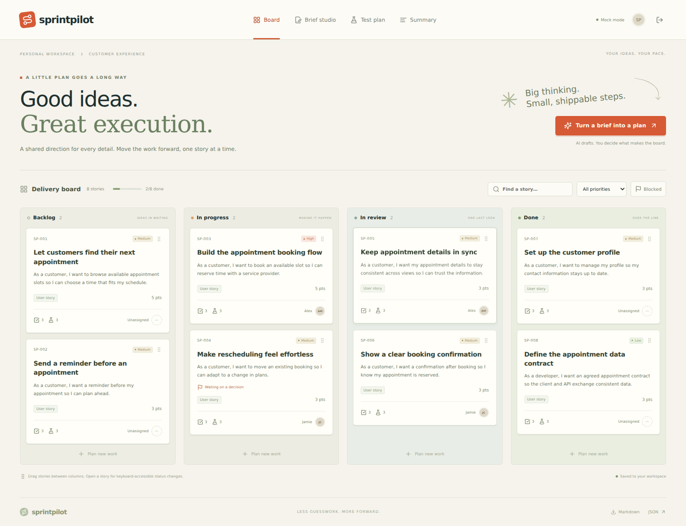
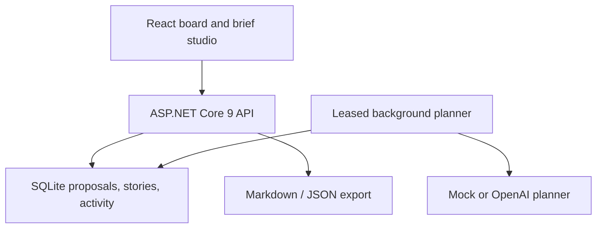

# SprintPilot AI — From a Spark to Shipped

A **.NET 9 + React + OpenAI** portfolio application that turns requirements into an editable delivery proposal. Review user stories, acceptance criteria, implementation tasks and test cases, approve them onto a Kanban board, and track progress.

The interface is intentionally board-first: full-width top navigation, warm ivory paper surfaces, muted green typography, orange actions and a slide-out story inspector. There is no permanent sidebar or metrics-card dashboard.



## The working flow

**Write a brief → Generate a proposal → Review and edit → Approve onto the board → Track delivery → Export**

- **Brief studio:** paste requirements and receive a proposed plan with clarification questions.
- **Editable proposals:** change summaries, questions, stories, criteria, implementation tasks, estimates and test scenarios. Add or remove proposed stories before approval.
- **One-time approval:** approval creates stories atomically; repeated approval returns the same story IDs.
- **Kanban board:** drag stories between Backlog, In progress, In review and Done. Keyboard/touch users can use the inspector's Status selector.
- **Story inspector:** edit details, record an assignee label, add blockers and record manual test results.
- **Test plan:** filter positive, negative and boundary cases by kind/result.
- **Summary:** a deterministic snapshot of recorded status, blockers, estimates and manual test results.
- **Exports:** download approved board stories and test plans as Markdown or JSON.
- **No-key demo:** Mock mode works without external AI calls.

This is a local portfolio demo. Sample people and project stories are fictional; seeded Done stories do not imply tests have actually executed.

## Start on Windows

Prerequisites: **.NET 9 SDK** and **Node.js 22 or newer**. Visual Studio is optional; if used, install a version/tooling that supports .NET 9.

1. Extract the entire ZIP into a writable folder.
2. Run `scripts/start.cmd`.
3. Wait for both terminals to show that the servers are running.
4. Open **http://localhost:5176**.
5. Sign in with `demo@sprintpilot.local` / `DemoPass123!`.

Keep both terminals open. The first launch downloads NuGet/npm dependencies and creates a SQLite database. **Port 5176 is the frontend. Port 5092 is the API.**

| Account | Password | Initial content |
|---|---|---|
| `demo@sprintpilot.local` | `DemoPass123!` | Eight appointment-experience stories across four columns |
| `second@sprintpilot.local` | `DemoPass123!` | Empty board, useful for your own demonstration |

## Manual launch

From the repository root in terminal 1:

```bash
dotnet restore SprintPilot.sln
dotnet run --project src/SprintPilot.Api --launch-profile SprintPilot.Api
```

In terminal 2:

```bash
cd frontend
npm ci
npm run dev
```

Then open http://localhost:5176. On macOS/Linux, `bash scripts/start.sh` performs the same startup steps. Use one hostname consistently because cookies are host-scoped.

For Visual Studio, open `SprintPilot.sln`, run `SprintPilot.Api`, and start Vite separately inside `frontend`. Opening the API root returns a helpful JSON message pointing to the frontend URL.

## Five-minute portfolio demonstration

1. Sign in using **Fresh start**.
2. Open **Brief studio**, give the brief a title, and paste one or more requirements from `samples/appointment-brief.txt`.
3. Click **Generate a proposal** and wait for Ready. No board stories exist yet.
4. Read the questions. Expand stories, tailor the acceptance criteria/tests, and save corrections.
5. Click **Approve & add to board**. Stories appear in Backlog with tests marked Not run.
6. Open a story, assign a name, and move it to In progress. Save and close.
7. Drag the card to In review. Try blocking a story and then moving it to Done: the server rejects that move until the blocker is resolved.
8. Record a test result in the inspector, then inspect Test plan and Summary.
9. Export Markdown or JSON.

Assignee names are text labels, not real user invitations. Test results are manual records; no generated code or tests are executed by the app. Summary is based on stored data rather than an AI narrative.

## Mock and OpenAI modes

| Aspect | Mock | OpenAI |
|---|---|---|
| API key | None | Required |
| Generation | Generic deterministic templates from up to three nonempty requirement lines | Structured model output grounded in the supplied brief |
| Questions | Fixed useful starter questions | Proposed clarification questions |
| Estimates | Default provisional 3 points | Provisional estimates from allowed point values |
| Tests | Generic Positive/Negative/Boundary examples | Proposed cases specific to the brief, subject to model quality |
| Approval | Human | Human |
| Board changes | Only after explicit approval | Only after explicit approval |

Mock mode is a workflow demonstration, not semantic requirement analysis. Both modes need review. AI can invent assumptions or miss important cases even when its JSON is valid.

## Enable OpenAI

Stop the backend and run from the repository root:

```bash
dotnet user-secrets set "AI:Provider" "OpenAI" --project src/SprintPilot.Api
dotnet user-secrets set "OpenAI:ApiKey" "YOUR_API_KEY" --project src/SprintPilot.Api
dotnet user-secrets set "OpenAI:Model" "gpt-4o-mini" --project src/SprintPilot.Api
```

Restart the API, refresh the browser and generate a new proposal. Existing Ready/Applied proposals keep their original provider and content. Failed proposals can be retried with the current provider.

To return to Mock:

```bash
dotnet user-secrets set "AI:Provider" "Mock" --project src/SprintPilot.Api
```

User secrets are development convenience, not an encrypted production vault. Keep the API key out of Git and out of React. OpenAI API usage is billed separately from ChatGPT subscriptions. Model access depends on your API project; the model name is configurable.

The backend uses direct HTTP calls to `POST https://api.openai.com/v1/responses` with `store:false`, `text.format.type=json_schema`, `strict:true` and a maximum of 8,000 output tokens. The prompt asks for bounded stories/questions and all tests as Not run. Incomplete responses, refusals, malformed output and invalid plans are rejected. No tools, code execution, email sending or remote issue creation are available to the model.

The brief title and source requirements are sent to OpenAI in live mode. Mock mode makes no OpenAI requests. `store:false` is not a guarantee of zero provider retention; review provider data controls before using confidential client requirements.

## Configuration reference

| Setting | Default | Meaning |
|---|---|---|
| `AI:Provider` | `Mock` | Exactly `Mock` or `OpenAI` |
| `OpenAI:ApiKey` | Unset | Required at startup for live mode |
| `OpenAI:Model` | `gpt-4o-mini` | Responses model with structured output support |
| `ConnectionStrings:SprintPilot` | `Data Source=sprintpilot.db` | SQLite file relative to API working directory |
| `Worker:Enabled` | `true` | Background proposal generation |
| `Demo:Seed` | `true` | Seeds only in Development and when no users exist |
| `AllowedHosts` | `localhost;127.0.0.1;api` | Host-header filtering |
| `ASPNETCORE_ENVIRONMENT` | Development through launch profile | User secrets, seeding and cookie behavior |

Environment keys use `__`, e.g. `AI__Provider`, `OpenAI__ApiKey`, `OpenAI__Model`, `ConnectionStrings__SprintPilot`. Environment configuration overrides JSON and user secrets. `.env` is read by Docker Compose, not automatically by the CLI application.

Limits: 30 briefs/account; 100 stories/account; 1–6 stories/proposal; title 3–100 characters; source 20–20,000 characters; 1–12 acceptance criteria and tasks/story; 3–12 test cases/story, including Positive, Negative and Boundary. Individual list entries are capped at 700 characters. Allowed estimates: 1, 2, 3, 5, 8, 13. Request body limit: 1 MiB. Login and configured write routes share a process-local limit of 30 requests/minute per authenticated user or anonymous IP.

## Local Docker alternative

```bash
docker compose up --build
```

Open http://localhost:5176. Optional: copy `.env.example` to `.env`, configure the provider/key, then recreate containers. The `sprintpilot-data` volume retains the database. `docker compose down` retains it; **`docker compose down -v` deletes all data**.

Compose is a local Development-mode demo bound to loopback, with demo passwords and HTTP. It is not a public deployment configuration. Docker execution was not verified in the supplied environment.

## Architecture



The backend separates API endpoints, plan validation, provider adapters and background generation. EF Core stores proposal/story JSON documents alongside indexed ownership, state and version fields. SQLite transactions make proposal application atomic; a unique proposal/index key prevents duplicate stories. The project uses Minimal APIs rather than a large enterprise template.

See [technical design](docs/TECHNICAL-DESIGN.md), [test cases](docs/TEST-CASES.md) and [verification](docs/VERIFICATION.md).

## Repository structure

```text
SprintPilot.sln
src/SprintPilot.Api/
  Program.cs               Startup, authentication, limits
  Models.cs                Entities and request contracts
  Validation.cs            Plan, story and workflow rules
  Planner.cs               Mock and OpenAI adapters
  ProposalWorker.cs        Durable generation, retries and leases
  Api.cs                   Proposals, board, inspector, summary, exports
  Seed.cs                  Fictional demo board
frontend/src/
  main.tsx                 Board, brief studio, inspector, test plan, summary
  api.ts                   Typed HTTP client/contracts
  styles.css               Responsive paper-inspired design
frontend/tests/            Browser workflow
tests/SprintPilot.Tests/   Backend unit/integration tests
samples/                   Example requirements
scripts/                   Windows/Unix startup
docs/                     Technical design, tests, screenshots
.github/workflows/ci.yml   Build and test workflow
compose.yaml               Optional local Docker setup
```

## API overview

Login establishes the session cookie. Authenticated routes are owner-scoped. Mutations require `X-SprintPilot: 1`; the frontend provides it. No permissive CORS policy is configured.

| Method | Route | Purpose |
|---|---|---|
| GET | `/health` | Process liveness only |
| POST | `/api/auth/login` | `{email,password}` |
| GET / POST | `/api/auth/me`, `/api/auth/logout` | Current user/provider; logout |
| GET | `/api/board` | Current user's stories |
| GET | `/api/stories/{id}` | Story plus activity history |
| PUT | `/api/stories/{id}` | Versioned content/status/assignee/blocker edit |
| POST | `/api/stories/{id}/move` | `{version,status}` |
| GET / POST | `/api/proposals` | List; `{title,source}` creates queued brief |
| GET | `/api/proposals/{id}` | One owned proposal and its original source |
| PUT | `/api/proposals/{id}` | `{version,plan}`; Ready state only |
| POST | `/api/proposals/{id}/approve` | `{version}`; creates board stories once |
| POST | `/api/proposals/{id}/retry` | `{version}`; Failed state only |
| GET | `/api/summary` | Current recorded status/test totals and blockers |
| GET | `/api/export?format=md` | Markdown backlog and test plan |
| GET | `/api/export?format=json` | JSON board content |

Invalid input returns 400, missing session 401, missing/foreign resources 404, stale versions or invalid states 409, and rate limits 429. Failed background generation is visible on its proposal rather than holding the import request open.

## Tests and CI

```bash
dotnet test SprintPilot.sln -c Release
cd frontend
npm ci
npm run build
npx playwright install chromium
# Keep the API running in another terminal in Mock mode:
npm run test:e2e
```

**32 backend tests pass**. Coverage includes draft-only generation, idempotent approval, current-version requirements, isolation, blocker rules, test-result summaries, exports, retries, expired leases and OpenAI response contracts. The browser workflow verifies generation, correction, approval, drag-and-drop, manual test results, persistence and download.

Backend tests use isolated temporary databases and injected providers. They never call OpenAI. Browser tests use the empty demo account and leave created records behind; run them with a disposable local database. The CI file installs .NET 9, Node 22 and Chromium, runs tests and builds, then starts the API for Playwright. CI was not executed in a remote GitHub repository.

## Implementation boundaries

- Each account has one board. There are no real shared projects, invitations, organization roles or multiple sprint objects.
- The screen's Customer Experience workspace label is demo branding, not a project selector.
- Status changes are explicit user actions. The app does not implement or deploy the stories.
- Native browser drag-and-drop moves between columns only, not within-column ranking. Mobile can scroll the board horizontally and change status from the inspector.
- A story can be Done with tests Not run/Failed. These concepts remain separate and are visible in Summary.
- Blocking a Done story is rejected; resolve blockers before moving to Done.
- Closing the inspector, switching briefs or leaving the studio can discard unsaved edits. Save explicitly. Background polling does not overwrite an open proposal editor's local content.
- Proposals cannot be deleted/discarded through the API; they remain reviewable. Applied proposals are immutable; stories remain editable.
- Repeated brief creation is not deduplicated. Approval of the same proposal is idempotent, but similar separate proposals can create similar stories.
- SQLite schema initialization uses `EnsureCreated`; migrations are not supplied. Stored requirements and story text are not encrypted by the app.
- External Google Fonts are optional; system font fallbacks keep the interface functional without them.

Production work would add identity management, project/team roles, migrations, shared data-protection keys, quotas and distributed jobs, encrypted backups/retention, better audit snapshots, collaboration conflict resolution and evaluation of generated planning quality.

## Troubleshooting

- **Wrong screen:** use frontend port 5176; port 5092 serves API JSON.
- **.NET target error:** verify .NET 9 with `dotnet --list-sdks`; update IDE tooling or run from CLI.
- **Proposal stays Queued:** ensure the API/worker is running. The app polls about every four seconds.
- **AI generation failed:** verify the key, billing/model access and connectivity, then retry. Use a shorter brief if output was incomplete.
- **Approval/edit conflict:** another save changed the version. Reload the proposal or close/reopen the inspector; preserve your notes before discarding edits.
- **Approve does nothing twice:** repeated approval intentionally returns the existing stories.
- **Cannot move to Done:** clear the blocker with an explanation reflected in the work, save, then move.
- **Need to change source:** create a new brief. Generated proposals preserve their original source.
- **Need a clean demo:** stop the API, back up `src/SprintPilot.Api/sprintpilot.db`, then delete that disposable DB and its WAL/SHM files. This deletes all stored data; restart to reseed.

## Portfolio positioning

Suggested repository: `sprintpilot-ai-delivery-workspace`.

Explain why AI output is a proposal rather than an instruction to mutate the board; how approval is idempotent and atomic; why test definitions and execution results are different; and how version checks prevent stale edits. Show the new visual design alongside the earlier portfolio projects to demonstrate interface range.

Reference: [OpenAI structured outputs](https://developers.openai.com/api/docs/guides/structured-outputs). Dependencies retain their own licenses; choose a license for your repository before publishing.
