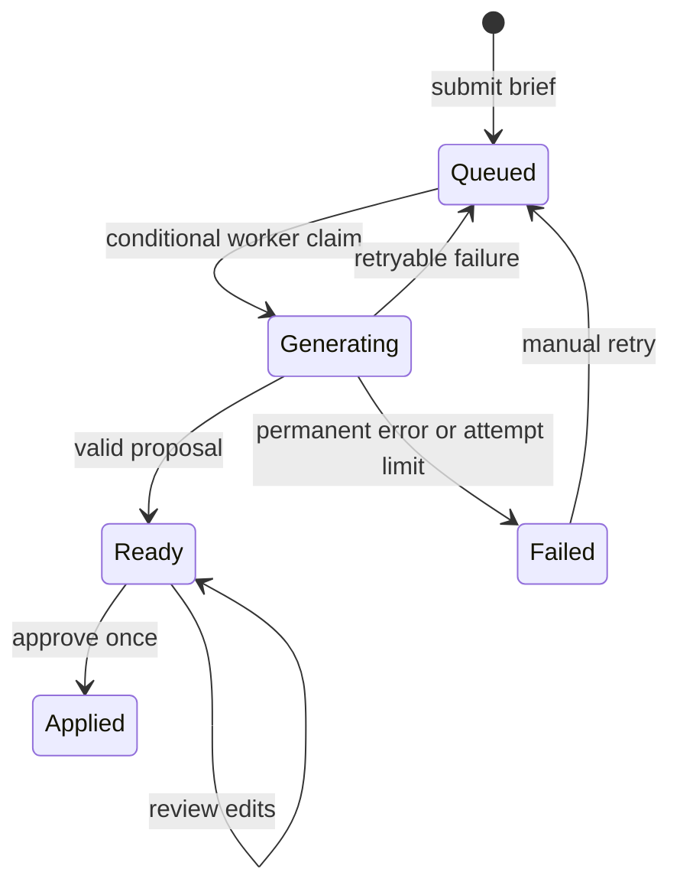

# Technical design

## Data model

A User owns Proposals and Stories. A Proposal stores original title/source, plan JSON, generation state, provider, attempts, lease, error and concurrency version. A Story stores structured content JSON plus owner, originating proposal/index, status, assignee label, blocker, timestamps and version. Activity rows reference stories. The unique `(ProposalId, ProposalIndex)` index complements transactional approval; seeded stories have null ProposalId.

Story content includes title, description, priority, estimate, acceptance criteria, tasks and test cases. Test cases have kind, scenario, expected result and manually recorded Result. Persisted JSON is deserialized into typed records and validated at mutation boundaries. Queries are scoped to the authenticated user; API callers cannot choose an owner ID.

## Proposal lifecycle

Import validates title/source and quota, then queues a record. The worker claims the oldest eligible row using its current version; claim increments version/attempts, assigns a unique lease and expires it in three minutes. Generation is bounded by a 100-second linked timeout and a 90-second provider HTTP timeout. Only the current lease holder can complete the row. An abandoned Generating job becomes eligible after lease expiry.

Retryable failures wait approximately two/four seconds, stopping after three provider attempts. Validation errors, incomplete responses and refusals fail permanently and permit manual retry. Interrupted attempts count toward the budget. External API billing is not exactly-once; retries or crashes can repeat calls. Manual retry resets attempts and uses current provider configuration.

## Proposal validation and AI

The strict Responses schema requires summary, questions and typed stories. Server validation additionally enforces string/list bounds, supported priority/points, all three test kinds and Not run for every proposed test. The provider cannot mark tests Passed, create stories directly or change board status.

OpenAI is asked to keep scope grounded, flag unclear business rules as questions and use provisional estimates. Source content is treated as untrusted text. Schema compliance is a structural guarantee only: relevance, completeness and business correctness still need human review. No tools, code execution or external integrations are exposed to the model.

Mock splits the first three nonempty requirement lines into generic templated stories. It preserves each source line in the description but does not understand it semantically. Questions/criteria/tasks/tests are illustrative templates. UI and documentation disclose this difference.

## Atomic, idempotent approval

Approval opens a SQLite transaction and loads the owned proposal. If Applied, it returns the already-created story IDs, even if the client repeats an old version. Otherwise it requires Ready plus the current version, validates the saved plan and checks the account story quota. All stories, initial activity events and the Applied state update commit together.

The default immediate SQLite transaction serializes competing writes; the unique origin index provides an additional storage invariant. This protects against duplicate submission for the same proposal. It does not deduplicate multiple briefs with similar text. There is no generic idempotency key for brief creation.

## Board and editor concurrency

Story updates require the current integer version, validate content and workflow, increment version and append an activity event. Moves use the same version rule; a no-op move to the same status returns without a new event. A blocked story cannot be Done. Status does not assert automated test success.

The frontend polls board/proposals every four seconds. The inspector keeps a local snapshot until saved/reopened. Proposal edits also hold a local version and content; polling does not silently replace them. Stale edits return 409. Reload proposal explicitly discards local edits and adopts the server version. Switching pages/briefs or closing the inspector can discard unsaved state; no autosave is claimed.

Native drag-and-drop changes a column, not ordering. Card order follows ascending database ID. A status selector offers keyboard and touch alternatives. Requests disable relevant controls while saving; the server remains authoritative on conflicts and validation.

## Summaries and test results

Summary is deterministic aggregation of current stored stories/tests, generated on request. It includes counts by state, completed/total estimates, blockers, done stories and manual Passed/Failed/Not run counts. It is a workspace snapshot, not a real time-boxed sprint report, velocity metric or predicted completion date. It is not a second AI call.

Tests in a proposal are definitions, not executed code. The inspector records a person's result choices. Done stories may still have failing or unrun tests; Summary explicitly shows that distinction. Activity records who changed a story/status, not a full tamper-proof history of every prior field/test value.

## Security, transport and limits

ASP.NET password hashing protects seeded passwords. Sessions use an eight-hour HttpOnly, SameSite Strict cookie, Secure outside Development. Mutations require `X-SprintPilot: 1`; browser requests remain same-origin through Vite/Nginx and no permissive CORS policy is configured. The header is not an authentication token.

Rate limiting is process-local, 30 requests/minute per user or anonymous IP for configured login/write routes. Brief/story quotas bound this demo's storage. There is no signup, multi-user project authorization, password reset, daily provider budget or distributed rate limit.

All content is rendered as escaped text in React. Markdown export HTML-encodes source strings and escapes common Markdown syntax; JSON is served as an attachment. Exports contain only owned board stories, not unapproved proposals. Files are generated on demand and not stored on the server.

## Operations and production gap

SQLite stores source and generated content in plaintext unless underlying storage encrypts it. `EnsureCreated` is initialization, not schema migration. Database backup, retention, deletion and restore are not implemented. The demo has no public registration, and production mode does not seed users.

Vite uses 5176 and proxies API requests to 5092. Local Docker uses Nginx and a named SQLite volume. Public deployment requires HTTPS, properly configured trusted proxies/hosts, managed identity, secure secret storage, persistent/shared data-protection keys, migrations, encrypted backups and isolated/distributed job processing.

OpenAI receives the source brief; `store:false` does not establish a zero-retention agreement. Sanitized provider failures are shown in the UI; logs record exception type, not the API key or response body. No live provider request was made during supplied verification.
